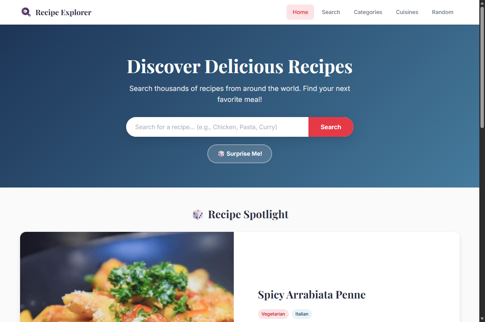
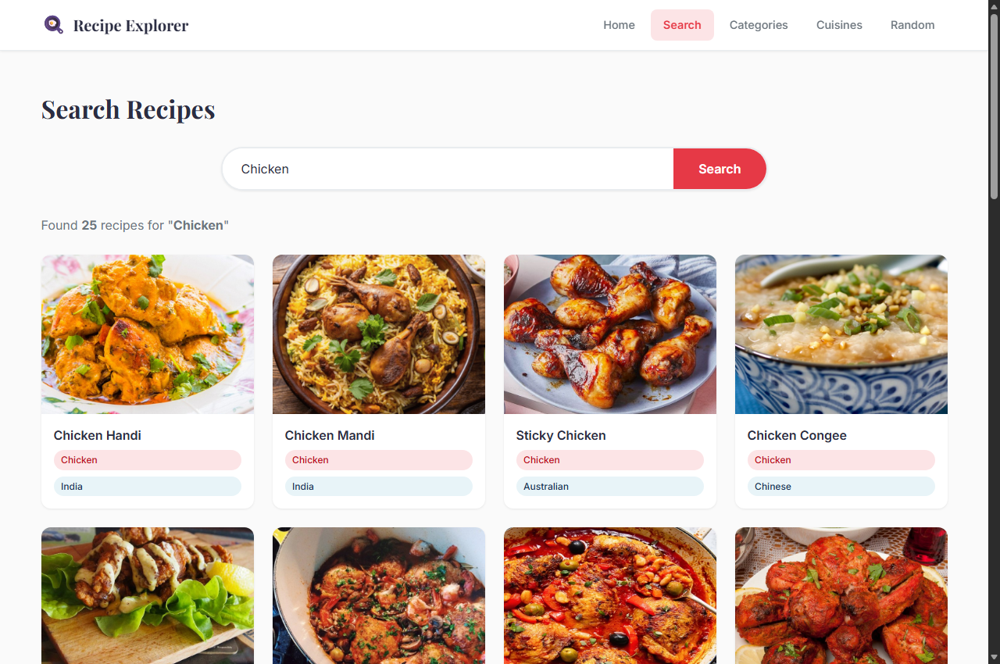
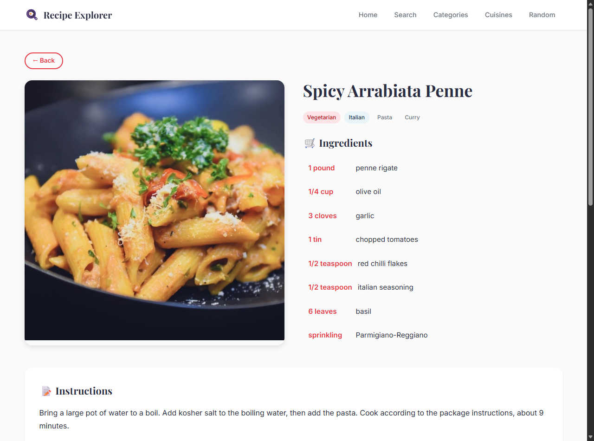
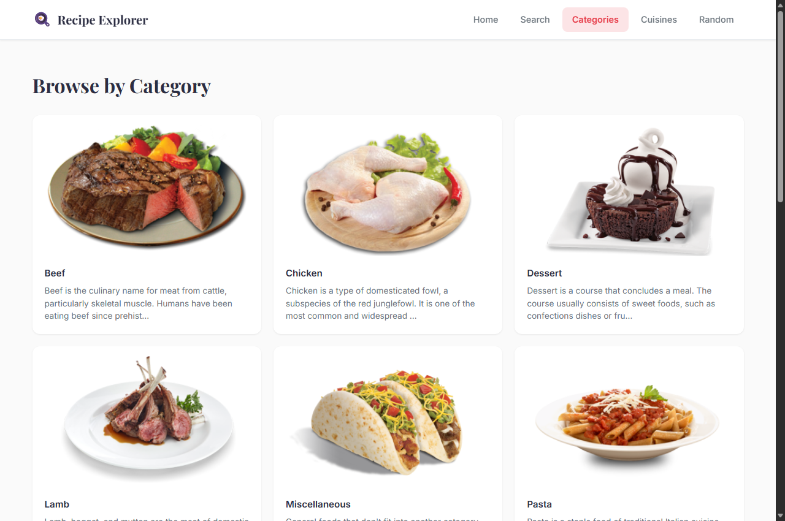
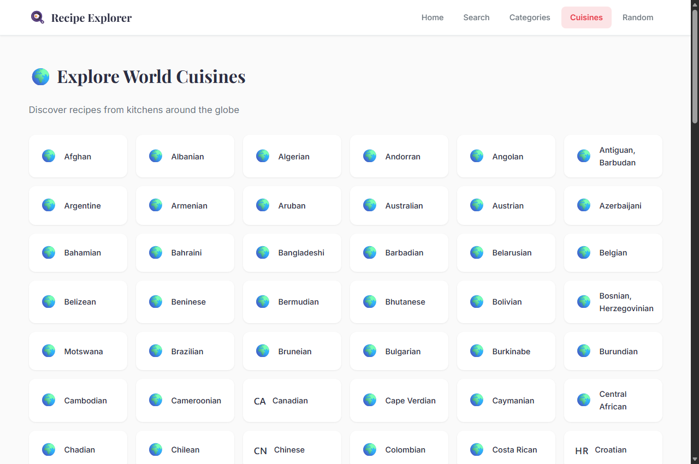
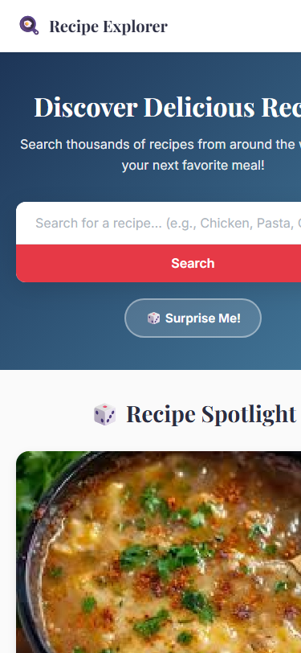

<p align="center">
  <span style="font-size: 3rem;">🍳</span>
</p>

<h1 align="center">Recipe Explorer</h1>

<p align="center">
  A polished recipe-discovery web application built with PHP and the TheMealDB REST API.<br>
  Search recipes, browse categories, explore world cuisines, and discover random meals.
</p>

<p align="center">
  
  
  
  
</p>

---

## 📋 Overview

**Recipe Explorer** is a PHP web application that integrates with [TheMealDB](https://www.themealdb.com/api.php) free REST API to provide a complete recipe-discovery experience. Users can search for meals by name, browse 14 food categories, explore cuisines from around the world, view detailed recipe information with ingredients and cooking instructions, and discover random recipes.

This project demonstrates PHP REST API integration: the PHP backend sends HTTP requests to TheMealDB, decodes JSON responses, and renders dynamic HTML pages — all without frameworks, databases, or build tools.

## ✨ Features

| Feature | Description |
|---------|-------------|
| 🔍 **Recipe Search** | Search meals by name with result count and empty-state handling |
| 📂 **Category Browsing** | Browse 14 food categories with descriptions and thumbnail images |
| 🌍 **World Cuisines** | Explore recipes from 180+ cuisines with flag emoji indicators |
| 🎲 **Random Discovery** | Get a random recipe suggestion — click and discover something new |
| 📖 **Recipe Details** | Full recipe view with ingredients, measurements, step-by-step instructions, and embedded YouTube video tutorials |
| 🖼️ **Recipe Spotlight** | Homepage features a randomly selected recipe as a spotlight section |
| 📱 **Responsive Design** | Fully responsive layout that works on desktop, tablet, and mobile |
| ⚠️ **Error Handling** | Graceful handling of API errors, empty results, missing images, and invalid input |

## 📸 Screenshots

### Homepage


### Search Results


### Recipe Detail


### Category Browsing


### World Cuisines


### Mobile View


> **Note:** Screenshots are captured from the actual running application.

## 🛠️ Technologies

| Technology | Purpose |
|-----------|---------|
| **PHP 8.x** | Backend: API requests (`file_get_contents()`), JSON decoding (`json_decode()`), HTML rendering |
| **HTML5** | Page structure and semantic markup |
| **CSS3** | Responsive design with CSS Grid, Flexbox, custom properties, and media queries |
| **JavaScript (Vanilla)** | Mobile navigation toggle, image error fallbacks |
| **TheMealDB API** | Recipe data source (free V1 API with educational key `1`) |
| **Google Fonts** | Typography (Inter for body, Playfair Display for headings) |

## 🔗 TheMealDB API

This application uses [TheMealDB](https://www.themealdb.com/api.php) free V1 API with the documented educational/test key `1`.

### Endpoints Used

| Endpoint | Purpose | Example |
|----------|---------|---------|
| `search.php?s={name}` | Search meals by name | `search.php?s=Chicken` |
| `lookup.php?i={id}` | Get full meal details by ID | `lookup.php?i=52771` |
| `random.php` | Get a random meal | `random.php` |
| `categories.php` | List all categories with descriptions | `categories.php` |
| `list.php?a=list` | List all cuisine areas | `list.php?a=list` |
| `filter.php?c={category}` | Filter meals by category | `filter.php?c=Seafood` |
| `filter.php?a={area}` | Filter meals by cuisine area | `filter.php?a=Italian` |

**Base URL:** `https://www.themealdb.com/api/json/v1/1/`

All endpoints return JSON with a `meals` (or `categories`) top-level key. The search endpoint returns `null` for the `meals` field when no results are found.

## 📁 Project Structure

```
recipe-hub/
├── index.php                # Homepage — hero search, spotlight, categories
├── search.php               # Search results page
├── category.php             # Category listing and category-filtered meals
├── area.php                 # Cuisine listing and area-filtered meals
├── recipe.php               # Full recipe detail page
├── random.php               # Random recipe redirect
├── includes/
│   ├── api.php              # TheMealDB API request functions
│   ├── functions.php        # Shared utilities (escaping, rendering)
│   ├── header.php           # HTML header and navigation template
│   └── footer.php           # HTML footer template
├── assets/
│   ├── css/
│   │   └── style.css        # Complete stylesheet
│   └── js/
│       └── app.js           # Vanilla JavaScript (nav toggle, etc.)
├── docs/
│   ├── PROJECT_REPORT.md    # Academic project report
│   └── screenshots/         # Application screenshots
├── .gitignore
└── README.md
```

## 📋 Prerequisites

- **PHP 8.0 or higher** with the following extensions enabled:
  - `openssl` (for HTTPS requests)
  - `json` (built-in)
  - `mbstring` (recommended)
- **A web browser**
- **Internet connection** (required to fetch data from TheMealDB API)

## 🚀 Installation & Setup (Windows)

1. **Install PHP** if not already installed:
   - Download PHP from [php.net/downloads](https://www.php.net/downloads)
   - Extract to a directory (e.g., `C:\php`)
   - Add the PHP directory to your system PATH

2. **Enable required extensions** in your `php.ini`:
   ```ini
   extension_dir = "ext"
   extension=openssl
   extension=curl
   extension=mbstring
   ```
   If no `php.ini` exists, copy `php.ini-development` to `php.ini` and uncomment the lines above.

3. **Clone the repository:**
   ```bash
   git clone https://github.com/anas-barkallah/recipe-hub.git
   cd recipe-hub
   ```

4. **Start the PHP development server:**
   ```bash
   php -S localhost:8000
   ```

5. **Open your browser** and navigate to:
   ```
   http://localhost:8000
   ```

## 🧑‍🍳 How to Use

1. **Search Recipes** — Use the search bar on the homepage or the Search page to find meals by name (e.g., "Chicken", "Pasta", "Curry").

2. **Browse Categories** — Click "Categories" in the navigation to see all 14 food categories (Beef, Chicken, Dessert, Seafood, etc.). Click any category to see its recipes.

3. **Explore Cuisines** — Click "Cuisines" to see recipes from different world cuisines. Flag emojis help identify each country's cuisine.

4. **Random Recipe** — Click "🎲 Surprise Me!" on the homepage or "Random" in the navigation to discover a randomly selected recipe.

5. **View Recipe Details** — Click any recipe card to see the full recipe with:
   - High-quality food image
   - Category and cuisine tags
   - Complete ingredient list with measurements
   - Step-by-step cooking instructions
   - Embedded YouTube video tutorial (when available)
   - Source link

## 🔄 Data Flow

The application follows this request-response flow:

```
User Browser                     PHP Server                    TheMealDB API
     │                               │                              │
     │  1. HTTP Request              │                              │
     │  (e.g., /search.php?q=Chicken)│                              │
     │──────────────────────────────>│                              │
     │                               │  2. file_get_contents()      │
     │                               │  HTTPS GET to API endpoint   │
     │                               │─────────────────────────────>│
     │                               │                              │
     │                               │  3. JSON response            │
     │                               │<─────────────────────────────│
     │                               │                              │
     │                               │  4. json_decode() → PHP array│
     │                               │  5. Render HTML with data    │
     │                               │                              │
     │  6. HTML response             │                              │
     │<──────────────────────────────│                              │
     │                               │                              │
     │  7. Browser renders page      │                              │
     │  (images loaded from API URLs)│                              │
```

1. The user's browser sends a request to the PHP server
2. PHP uses `file_get_contents()` with HTTPS to query TheMealDB
3. TheMealDB returns JSON data
4. PHP decodes the JSON into an associative array with `json_decode()`
5. PHP loops through the data and renders HTML using `htmlspecialchars()` for safe output
6. The complete HTML page is sent to the browser
7. The browser renders the page and loads recipe images directly from TheMealDB's CDN

## 🔒 Security & Error Handling

### Input Validation
- All user input (`$_GET` parameters) is validated and sanitized before use
- Search queries are trimmed and length-limited (100 characters max)
- Meal IDs are verified to contain only digits using `ctype_digit()`
- Category and area names are length-limited

### Output Escaping
- All dynamic content is escaped with `htmlspecialchars()` via the `e()` helper function
- This prevents Cross-Site Scripting (XSS) attacks

### API Error Handling
- Network failures are caught with `@file_get_contents()` error suppression
- JSON decode errors are checked with `json_last_error()`
- HTTP timeouts are configured (10 seconds)
- Missing API fields use null-coalescing operators (`??`) for safe access
- Empty/null `meals` arrays are handled with appropriate user-facing messages
- Failed image loads show an SVG placeholder via JavaScript

### API Key
- The key `1` is TheMealDB's documented free educational/test key
- It is not a secret and is intended for development and learning purposes

## ⚡ Limitations

- **No caching:** Every page load makes fresh API requests. A production app would cache responses to improve performance.
- **No database:** The application has no local data storage — all data comes from the API in real time.
- **API rate limits:** TheMealDB's free tier may have undocumented rate limits.
- **Filter results are partial:** The filter endpoint returns only meal name, thumbnail, and ID — not full details. Full details require a separate lookup call.
- **Search limitations:** The search endpoint only matches meal names, not ingredients or instructions.
- **PHP development server:** The built-in PHP server is for development only, not production deployment.
- **No user accounts:** There is no way to save favorite recipes or create shopping lists.

## 🔮 Possible Future Improvements

- Add response caching (file-based or Redis) to reduce API calls
- Implement search by ingredient (`filter.php?i=`)
- Add a favorites system using browser `localStorage`
- Implement pagination for large result sets
- Add a "print recipe" button with print-friendly styling
- Add recipe sharing via URL
- Create a meal planner or shopping list feature

## 📄 Documentation

- [Project Report](docs/PROJECT_REPORT.md) — Detailed academic report covering API analysis, implementation, testing, and development process

## 🙏 Credits

- **Recipe Data:** [TheMealDB](https://www.themealdb.com/) — Free recipe API
- **Fonts:** [Google Fonts](https://fonts.google.com/) — Inter and Playfair Display
- **Icons:** Native emoji characters
- **Built with:** PHP, HTML, CSS, and vanilla JavaScript

---

<p align="center">
  <em>Academic project — Built to demonstrate PHP REST API integration</em>
</p>
